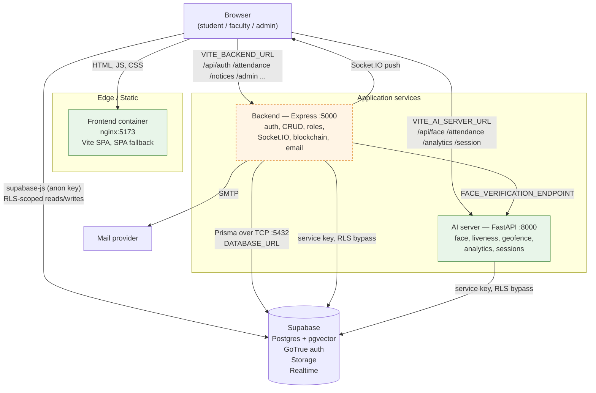

# AISMS — Architecture

> Status: living document. Describes the system **as the code is today**,
> plus an explicit plan for where it is going.
> Last reviewed: Phase C (infrastructure) of the production-readiness plan.

---

## 1. The three services

AISMS is a smart-attendance platform for universities. It is built as three
independently deployable services plus a managed backend (Supabase).

| Service | Directory | Stack | Port | Container |
|---|---|---|---|---|
| **Frontend** | `src--frontend/` (Vite entry: `index.html`) | React 18 + TypeScript + Vite + Tailwind | 5173 (nginx) | `./Dockerfile` |
| **Backend** | `server--backend/` | Node 20 + Express 4 + TypeScript + Prisma 5 + Socket.IO | 5000 | `./server--backend/Dockerfile` |
| **AI server** | `ai-server/` | Python 3.12 + FastAPI + uvicorn + InsightFace/ONNX + scikit-learn | 8000 | `./ai-server/Dockerfile` |
| **Database / auth** | managed | Supabase (Postgres + PostgREST + GoTrue + Storage) + pgvector | — | — |

Supporting pieces that are *not* separate services:

- `supabase/migrations/` — numbered SQL migrations, the authoritative
  schema. See [MIGRATIONS.md](./MIGRATIONS.md).
- `supabase/functions/` — Supabase Edge Functions.
- `nginx.conf` — SPA server config for the frontend container.

---

## 2. Request flow



### The three request paths in detail

1. **Direct database access (the dominant path).**
   The browser holds a Supabase anon key and talks to PostgREST and GoTrue
   itself (`src--frontend/lib/supabase.ts`, `lib/api.ts`). **Every read and
   write is authorized by Postgres row-level security policies**, not by
   application code. This is why `supabase/migrations/002_rls_policies.sql`
   and `005_fix_rls_camelcase.sql` are the two most security-critical
   migrations in the repository.

2. **AI path.**
   The browser posts a captured frame to the FastAPI AI server
   (`VITE_AI_SERVER_URL`). Every `/api/*` router there sits behind
   `require_user` (validates the Supabase JWT) and a per-router rate
   limiter (`ai-server/main.py`). The AI server performs face matching,
   liveness and geofence checks, then writes the result to Supabase with
   the service key.

3. **Backend path.**
   The browser calls the Express backend (`VITE_BACKEND_URL`) for
   operations that are not expressible as RLS-scoped CRUD: JWT issuance
   and refresh, MFA, password reset, role-gated bulk CSV import, the
   blockchain ledger, SMTP email, and the Socket.IO channel.
   `FACE_VERIFICATION_ENDPOINT` points back at the AI server, so the
   backend can request a face check without duplicating the model.

### Authentication in one paragraph

Supabase GoTrue owns identity. The browser holds a Supabase session JWT.
Both server services validate that JWT independently (`require_user` in
`ai-server/utils/auth.py`, `middleware/auth.ts` in the backend). The
backend additionally mints its **own** access/refresh JWT pair
(`utils/jwt.ts`, `JWT_SECRET` / `JWT_REFRESH_SECRET`) for routes it owns.
That means there are currently **two token systems in flight at once** —
this is the single most important structural fact about the codebase, and
it drives the deprecation plan in §5.

---

## 3. Where the authority for each concern lives

| Concern | Authority today | Enforcement point |
|---|---|---|
| Row-level data authorization | **Supabase (Postgres)** | RLS policies in `supabase/migrations/` |
| Identity, sign-up, session lifecycle | **Supabase GoTrue** | `handle_new_user()` trigger, `013_signup_role_lockdown.sql` |
| Face recognition, liveness, geofencing | **FastAPI AI server** | `ai-server/routes/`, model code in `ai-server/models/` |
| Predictive analytics, anomaly/fraud detection | **FastAPI AI server** | `ai-server/routes/analytics.py` |
| Attendance session windows and codes | **FastAPI AI server** | `ai-server/routes/session.py` + `009_attendance_sessions.sql` |
| App-level auth tokens, MFA, password reset | **Express backend** | `utils/jwt.ts`, `controllers/authController.ts` |
| Role-gated business operations, bulk import | **Express backend** | `middleware/auth.ts` `requireRole()`, `routes/index.ts` |
| Blockchain-style tamper-evident attendance ledger | **Express backend** | `utils/blockchain.ts` + `generate_attendance_hash()` in `001_initial_schema.sql` |
| Transactional email | **Express backend** | `utils/email.ts` (nodemailer/SMTP) |
| Real-time push to clients | **Express backend** (Socket.IO) + Supabase Realtime | `server--backend/src/index.ts` |
| Static asset serving, edge headers | **Frontend container** (nginx) | `nginx.conf` |

**The rule that matters:** authorization is currently enforced in two
places at once — RLS for anything that reaches Postgres directly, and
`requireRole()` in Express for anything routed through the backend. Those
two must be kept semantically identical, or the backend becomes a
privilege-escalation path around RLS.

---

## 4. Configuration and secrets

Every variable any service reads is documented in [`.env.example`](../.env.example),
generated from the source rather than from memory.

- **`VITE_*` variables are build-time, not runtime.** Vite inlines them into
  the JavaScript bundle during `npm run build`. Changing one requires a
  **rebuild**; restarting the container will not pick it up. The frontend
  Dockerfile therefore takes them as `ARG`s.
- **`VITE_` must never prefix a secret.** Anything with that prefix is
  published to every visitor. Only `VITE_SUPABASE_URL` and
  `VITE_SUPABASE_ANON_KEY` are meant to be public, and the anon key is
  safe only because RLS is the real boundary.
- **Two different Supabase keys.** `VITE_SUPABASE_ANON_KEY` (public, RLS-
  constrained) and `SUPABASE_SERVICE_KEY` (server-only, bypasses RLS).
  Some local `.env` files contain a `VITE_SUPABASE_SERVICE_ROLE_KEY`.
  Nothing in `src--frontend` reads it — it should be deleted, not
  "documented".

---

## 5. Legacy backend boundary and deprecation plan

### 5.1 The problem

The repository runs **two application backends over one database**:

- `server--backend/` — Express + Prisma, ~90 REST routes, its own JWT
  system, Socket.IO, SMTP, blockchain ledger, bulk CSV import.
- `ai-server/` — FastAPI, 4 routers, already enforcing Supabase JWT
  validation and per-route rate limits.

This duplication is not cosmetic. It produces concrete costs:

1. **Two token systems.** Supabase JWTs *and* Express-issued JWTs. Every
   service must decide which one it trusts; a token accepted by the wrong
   one is a security bug. Refresh, revocation and logout semantics differ.
2. **Two authorization models.** RLS in Postgres vs. `requireRole()` in
   Express. They must agree for every table and every role, and nothing
   enforces that they do.
3. **Two deployment surfaces.** `vercel.json` rewrites `/api/ai/*` and
   `/api/backend/*` to two different Railway services. `railway.json` and
   `railway-backend.json` describe two deployments. Each is a separate
   failure domain, health check and scaling decision.
4. **Two client base URLs.** `VITE_AI_SERVER_URL` and `VITE_BACKEND_URL`
   mean the browser's CORS surface is the union of both.
5. **`nginx.conf` proxies only `/api/ai/`.** There is no `/api/backend/`
   proxy, so the two services are not symmetrically reachable through the
   frontend origin today — a latent inconsistency in the edge layer.

### 5.2 Recommendation: converge on the FastAPI service, retire Express

**Long-term, AISMS should run exactly one application backend: the
FastAPI AI server, renamed to reflect that it is no longer only AI.**

Rationale:

- **The migration is already ~80% done for the AI side.** The AI server
  validates Supabase JWTs, applies rate limits, centralizes error
  handling, and returns no stack traces. The Express backend does the
  same, but its token system is the part that has to be dismantled
  anyway.
- **It is the service that owns the hard part.** Face recognition and
  inference have no Node equivalent that is not materially worse. Those
  capabilities are the product; they cannot be moved to a system that is
  being deprecated.
- **It eliminates the dual-token problem at the root.** If the surviving
  service authenticates with the Supabase JWT directly, the Express JWT
  pair can be retired instead of migrated.
- **It collapses deployment to one surface.** One Railway service, one
  health check, one CORS origin list, one set of logs to correlate when
  diagnosing an attendance failure.
- **It matches the data model.** RLS is already the primary
  authorization boundary, and Supabase is already the source of truth.
  A Node service sitting in front of it adds an authorization layer that
  has to be kept in sync with RLS but is not itself the boundary.

**What must move to FastAPI before Express can be deleted** (none of it is
blocked by the current design; it is mechanical porting of typed
Express handlers):

| Express capability | Target in FastAPI | Notes |
|---|---|---|
| JWT issuance / refresh / MFA | `routes/auth.py` | Replace with Supabase token exchange rather than reimplementing |
| Password reset / OTP / email verify | `routes/auth.py` | Already partly in `utils/` patterns |
| CRUD: notices, leaves, timetable, departments, courses, classes, users | `routes/crud.py` | Prefer thin handlers that write through the service role and lean on RLS |
| Bulk CSV import/export | `routes/bulk.py` | Move `xlsx`/`csv-parser` handling to Python equivalents |
| Analytics dashboards | `routes/analytics.py` (merge) | Overlaps the AI server's existing router — merge, do not duplicate |
| Blockchain ledger | `routes/ledger.py` | Port `utils/blockchain.ts` + `generate_attendance_hash()` semantics exactly; the DB function is already the source of truth |
| Email (nodemailer/SMTP) | `utils/email.py` | `aiosmtplib` or an HTTP provider client |
| Socket.IO real-time | Supabase Realtime | Prefer the managed channel; it removes a whole WebSocket server from the stack |
| Device trust, login history, security events | `routes/security.py` | Tables already exist (`008_cybersecurity_layer.sql`) |

**What should NOT move:** nothing belongs back in Express. The one
contested question is whether to keep Express purely as a WebSocket
broker. Recommendation: **no** — use Supabase Realtime, which the
frontend already depends on, and delete Express entirely rather than
keeping it in a reduced form.

### 5.3 Staged migration order

Each stage is independently deployable and reversible. Do not start stage
*n+1* until stage *n* is verified in production.

**Stage 0 — Freeze and instrument (no behaviour change).**
- Mark every Express route as `@deprecated` in its handler.
- Add a request counter per route to confirm which routes are actually
  live; a route with zero traffic over 30 days is a deletion candidate,
  not a migration candidate.
- Document in each Express controller which FastAPI module will replace it.

**Stage 1 — Auth convergence.**
- Frontend authenticates **only** via Supabase.
- FastAPI gains `routes/auth.py`: token refresh, MFA challenge, password
  reset, OTP. Emits Supabase-compatible sessions rather than
  `JWT_SECRET`-signed tokens.
- Backend keeps its routes but accepts the Supabase JWT. Add a
  compatibility shim that maps the legacy Express JWT claims onto the
  Supabase identity so nothing breaks mid-flight.
- *Exit criterion:* no client holds an Express-signed token.

**Stage 2 — Realtime off Express.**
- Move notification and attendance-update delivery to Supabase Realtime.
- Frontend swaps `socket.io-client` for the Realtime channel.
- *Exit criterion:* Socket.IO connection count at zero.

**Stage 3 — CRUD and bulk operations.**
- Port the read/write routers and bulk CSV import to FastAPI.
- Frontend repoints `VITE_BACKEND_URL` traffic to the FastAPI base URL,
  route group by route group, using a per-group feature flag.
- *Exit criterion:* every migrated route has been live behind a flag for
  one full attendance cycle (marking, leave approval, timetable edits)
  with no discrepancy reports.

**Stage 4 — Analytics, ledger, email.**
- Merge dashboard endpoints into the existing `routes/analytics.py`.
- Port the blockchain ledger, verifying parity against
  `generate_attendance_hash()` and the existing `blockchain_records`
  table before cutover.
- Port SMTP to Python.
- *Exit criterion:* ledger hashes produced by both implementations match
  on a fixed fixture dataset.

**Stage 5 — Delete Express.**
- Remove the backend service, its Dockerfile, `railway-backend.json`,
  the `/api/backend/*` rewrite in `vercel.json`, and the
  `VITE_BACKEND_URL` variable.
- Add the missing `/api/backend/` → FastAPI proxy to `nginx.conf` **or**
  retire that proxy concept entirely by serving the API from one origin.
- Update `docs/ARCHITECTURE.md` (this file) to describe a one-backend
  system, and remove the `VITE_BACKEND_URL` section from `.env.example`.

### 5.4 Interim guardrails (until stage 5 completes)

- Never add a new route to the Express backend. New capability goes to
  FastAPI.
- Never introduce a third authorization mechanism. Authorization is RLS
  plus `require_user`/`require_role` on the FastAPI side.
- Treat `supabase/migrations/` as the single schema authority. Prisma's
  `schema.prisma` is a *client-side* view; it must not be used to
  generate or alter production schema.

---

## 6. Local development

```bash
cp .env.example .env     # fill in Supabase + JWT + SMTP values

docker compose up -d --build
# frontend  http://localhost:5173
# backend   http://localhost:5000   (health: /api/health)
# AI server http://localhost:8000   (health: /health)

docker compose --profile postgres up -d   # optional local Postgres + pgvector
```

Without Docker:

```bash
npm install && npm run dev                      # frontend, :5173
npm --prefix server--backend run build && npm --prefix server--backend start
cd ai-server && uvicorn main:app --reload      # :8000
```

## 7. Production topology

- **Frontend** → Vercel (`vercel.json`, output `dist`).
- **AI server** → Railway (`railway.json`, Dockerfile at `ai-server/Dockerfile`,
  healthcheck `/health`).
- **Backend** → Railway (`railway-backend.json`), **scheduled for removal
  per §5**.
- **Database** → Supabase managed project.

Container images are multi-stage and run as non-root (`aisms` uid 1001 for
the AI server, `node` uid 1000 for the backend, nginx uid 101 for the
frontend). `.dockerignore` in each build context excludes `.env*`,
`node_modules`, `venv`, `uploads` and `dist`, so no secret can reach an
image layer.

> **Deployment caveat:** `railway.json` at the repository root points at
> `ai-server/Dockerfile` with a repository-root build context, but that
> Dockerfile now expects the `ai-server/` directory as its context
> (`COPY requirements.txt ./`). Either set Railway's build context to
> `ai-server`, or use the `ai-server/railway.json` manifest. This was not
> changed in Phase C because `railway.json` is outside the owned scope.